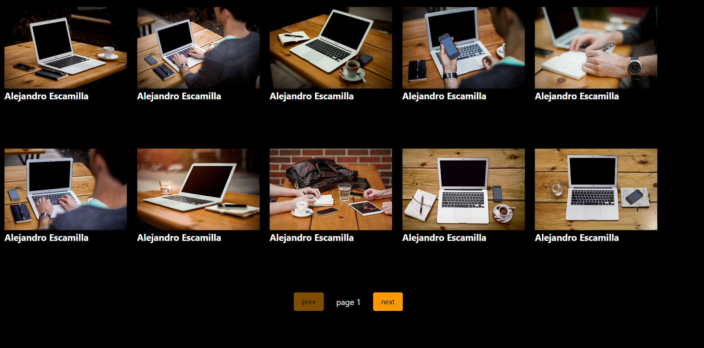
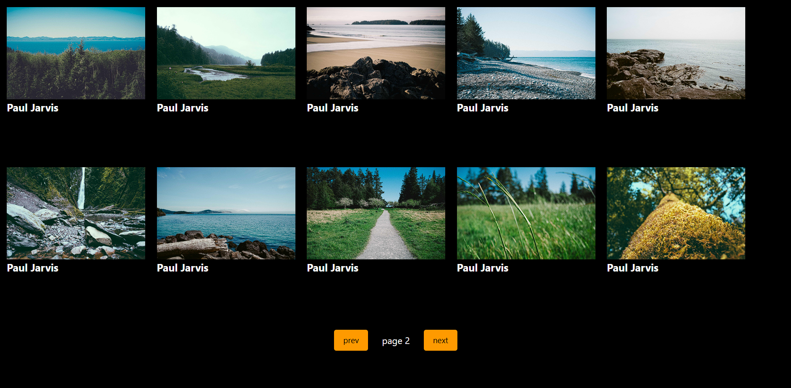

# Image Gallery App

A responsive **Image Gallery App** built using **React**, **Tailwind CSS**, and **Axios**. The application fetches images dynamically from the **Picsum Photos API** and displays them in a clean, modern gallery layout. Users can navigate through multiple pages of images using simple pagination controls.

This project demonstrates practical implementation of React Hooks, API integration, asynchronous data fetching, state management, and dynamic rendering.

---

## Features

* Fetches images dynamically from the Picsum Photos API
* Displays images in a responsive gallery layout
* Shows the author's name for each image
* Previous and Next page navigation
* API requests using Axios
* Dynamic UI updates using React Hooks
* Responsive and clean user interface

---

## Technologies Used

* React
* JavaScript (ES6+)
* Tailwind CSS
* Axios
* Vite
* Picsum Photos API

---

## Project Structure

```text
GalleryApp/
├── public/
├── src/
│   ├── assets/
│   ├── components/
│   │   └── Card.jsx
│   ├── App.jsx
│   ├── App.css
│   ├── index.css
│   └── main.jsx
├── .gitignore
├── .oxlintrc.json
├── index.html
├── package.json
├── package-lock.json
├── vite.config.js
└── README.md
```

---

## Screenshots

### Landing Page



### Pagination / Next Page



---

## How to Use

1. Open the Image Gallery App.
2. Browse the images displayed on the current page.
3. Click **Next** to view the next set of images.
4. Click **Previous** to return to the previous page.
5. View the author's name below each image.

---

## Learning Objectives

This project helped me practice:

* React Functional Components
* React Hooks (`useState`, `useEffect`)
* API Integration
* Axios for HTTP Requests
* Asynchronous JavaScript
* State Management
* Dynamic List Rendering
* Pagination
* Responsive UI Development

---

## Installation & Setup

### 1. Clone the repository

```bash
git clone https://github.com/naitikbansal138/GalleryApp.git
```

### 2. Navigate to the project directory

```bash
cd GalleryApp
```

### 3. Install dependencies

```bash
npm install
```

### 4. Start the development server

```bash
npm run dev
```

### 5. Open the application

Open the local URL displayed in your terminal, usually `http://localhost:5173`.

---

## Future Improvements

* Add image search functionality
* Add a fullscreen image preview
* Implement lazy loading
* Add infinite scrolling
* Allow users to save favorite images
* Display loading skeletons
* Improve error handling for failed API requests

---

## API Used

**Picsum Photos API**

Endpoint: https://picsum.photos/v2/list

---

## Disclaimer

This project was created for educational purposes to practice React development, API integration, and responsive UI design. Images are provided by the Picsum Photos API.

---

## Author

**Naitik Bansal**

GitHub: https://github.com/naitikbansal138

---

If you find this project useful, consider giving it a star on GitHub!
